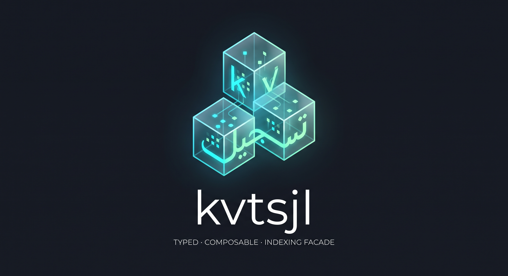
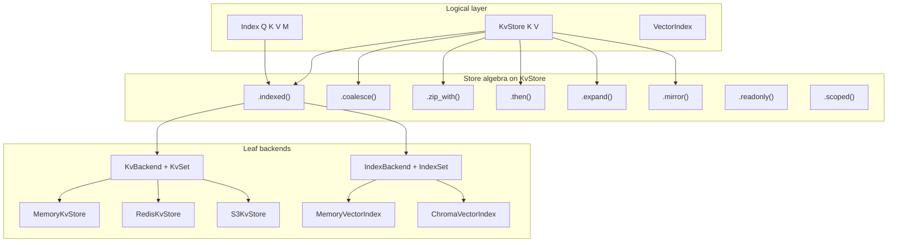
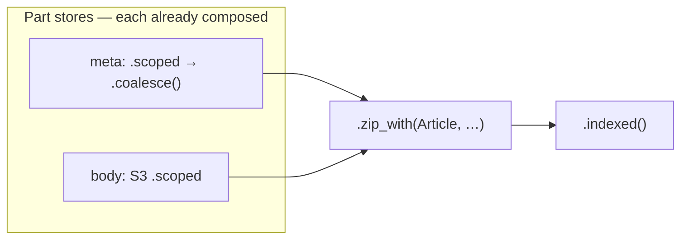

<p align="center">
  
</p>

**kvtsjl** (*kv-tasjil*, from Arabic *tasjīl* تسجيل — “recording”) is a **typed, composable Python library for key–value storage with first-class indexing**.

Define your domain keys and values once. Plug in Redis, S3, GCS, Azure Blob, SQL, filesystem, or in-memory backends without rewriting business logic. Attach exact, term, or vector indexes that stay in sync on every write—then search and hydrate documents from a single API.

Python **3.12+** · **pyright strict** · **zero required dependencies** · Apache 2.0

---

## Why kvtsjl?

Most KV libraries force you to choose early: either a thin dict wrapper around a driver, or a heavy ORM. kvtsjl sits in between:

| Problem | kvtsjl approach |
|--------|------------------|
| Backend lock-in | **Logical** `KvStore` / **physical** `KvBackend` split—swap leaves, keep callers |
| Ad-hoc search | **Indexes** attach to a store; writes sync automatically |
| Leaky key encoding | **`KvSet`** + **`SerDe`** wire domain types to bytes; **`Scope`** partitions namespaces |
| Cache / tiering hacks | **`KvStore` algebra** — `.coalesce()`, `.mirror()`, `.zip_with()`, `.then()`, `.expand()` |
| Opaque library blobs | **Footprint-free by default** — payload plus native object/file metadata only; swap kvtsjl for another client |
| Untyped I/O | Generics end-to-end; strict static checking in CI |

---

## Use cases

- **Session & config cache** — hot path on Redis, cold fallback to S3 or filesystem; promote hits with `.coalesce()` / `.fallback_read()`.
- **RAG / semantic search** — documents in object storage or Redis; vector index synced on write; search hydrates values from the same store.
- **Multi-tenant SaaS** — one `KvSet` schema; isolate tenants with `.scoped(tenant_id=…)` without separate client instances.
- **Migration & dual-read** — new primary store with read-through to a legacy backend until cutover completes.
- **Audit & replication** — `.mirror()` write-through to a secondary bucket or region while reads stay on primary.
- **Read-only workers** — indexers, exporters, and APIs wrap the store with `.readonly()` to block accidental writes.
- **Bring your own storage** — implement `KvBackend` or `IndexBackend` for DynamoDB, Postgres, an internal blob service, etc.; reuse composition and indexing unchanged.
- **Split documents** — `.zip_with(Article, meta=…, body=…)` joins part stores; each part keeps its own `.coalesce()` / `.scoped()` chain (see [Store algebra](#store-algebra)).

---

## Features

- **Typed CRUD** — `get` / `set` / `delete` + batch variants, `scan`, `get_or_set`
- **Atomic update** — `update(key, decide)` / `batch_update(keys, decide)`: keep, put or remove entries, decided from what they hold, on one compare-and-write per medium — a batch is one read and one write per round
- **Footprint-free medium** — default writes do not stamp library identity (`x-amz-meta-kvtsjl-*`, tags, sidecars)
- **Wire schema** — `KvSet` describes key/value serdes, layout, TTL; leaf backends own I/O
- **Scope views** — prefix namespaces without copying data
- **Multi-index search** — attach several indexes; `store.search(index, query)` returns keys or hydrated values
- **Vector indexes** — `MemoryVectorIndex` (exact L2) or optional **`ChromaVectorIndex`**
- **Store algebra** — `.map` / `.imap` / `.imap_keys`, `.zip` / `.zip_with` / `.zip_as`, `.then` / `.then_with`, `.expand` / `.expand_map`, `.coalesce`, plus `.mirror()`, `.indexed()`, `.readonly()`, `.scoped()`
- **Streaming** — `set_stream` / `read_stream` move file-sized values without holding them in memory, through compression and composition
- **Extensible adapters** — subclass `KvBackend` / `IndexBackend`; plug in custom serdes and binders
- **Optional integrations** — Pydantic serdes, Redis, S3/MinIO, GCS, Azure Blob, SQL (SQLite shipped), ChromaDB

---

## Architecture

Logical APIs stay backend-agnostic. Physical backends carry wire identity and medium-specific I/O. Indexes mirror the same split.



---

## Quick start

```python
from kvtsjl import KvSet, MemoryKvStore, SerDe

kvset = KvSet.with_str_keys(
    "users",
    key_serde=SerDe.identity(str),
    value_serde=SerDe.utf8_bytes(),
)
store = MemoryKvStore(kvset)

store.set("alice", "admin")
store.set("bob", "member")

assert store.get("alice") == "admin"
for key in store.scan(prefix="a"):
    print(key)  # alice
```

### Footprint-free storage

kvtsjl is a typed facade, not a proprietary format. **Default provision writes the value blob and whatever the medium already uses** (mtime, `LastModified`, Redis `EX` on flat keys). There are no `x-amz-meta-kvtsjl-*` keys, object tags, or sidecar files unless you **opt in at construction**.

Per-write TTL follows the same rule:

```python
from datetime import timedelta
from kvtsjl import TtlPolicy

store.set("a", "v")                         # KvSet.ttl_policy
store.set("a", "v", ttl=TtlPolicy.hourly()) # this key only
store.set("a", "v", ttl=TtlPolicy.none())   # never expire this key
store.batch_set({"a": "v", "b": "w"}, ttl=TtlPolicy(ttl_duration=timedelta(minutes=5)))
```

- **Memory**, **Redis flat keys**, and **SQL** honor `ttl=` natively (SQL via declared `updated_at` / `expires_at` columns).
- **Redis HASH collections** raise `KvStoreTtlUnsupported` on explicit `ttl=` (expiry is hash-wide).
- **S3 / GCS / Azure / filesystem** honor `ttl=` only when provisioned: `S3TtlMode.EXPIRES`, `GcsTtlMode.CUSTOM_TIME`, `AzureTtlMode.METADATA`, `FilesystemTtlMode.SIDECAR`. Those modes use a **standard header**, **platform field**, or an **explicit sidecar/metadata key**, not a hidden kvtsjl schema. Defaults (`OBJECT_TIME` / `MTIME`) raise on per-write `ttl=`.
- **Expired entries** on get/scan: default `expiry_gc=ExpiryGc.LAZY_DELETE` removes them from the medium; pass `ExpiryGc.HIDE` to treat as absent and leave cleanup to ops. Call `store.gc_expired(max_entries=N)` on a schedule (or on demand) to delete up to `N` expired entries under the current scope—works even with `HIDE`. Redis flat keys are removed by the server (`EX`); `gc_expired` is a no-op there.

Compress wire values at the leaf (`gzip` / `zlib` in core; `zstd` / `lz4` via optional extras):

```python
kvset = (
    KvSet.with_str_keys(
        "docs",
        key_serde=SerDe.identity(str),
        value_serde=SerDe.compressed("gzip", SerDe.json_bytes()),
    )
    # or: value_serde=SerDe.json_bytes() >> SerDe.wire_compressed("gzip")
    # or: ... SerDe.utf8_bytes()).with_compressed_value("gzip")
)
store = MemoryKvStore(kvset)
```

Apply compression on the **leaf** `KvSet` before `.mirror()`, `.coalesce()`, or `.indexed()`.

---

## Indexed search

Attach indexes with `.indexed(...)`. Mutations on the store sync every attached index.

```python
from kvtsjl import KvSet, MemoryKeyIndex, MemoryKvStore, MemoryTermIndex, SerDe

kvset = KvSet.with_str_keys("docs", key_serde=SerDe.identity(str), value_serde=SerDe.utf8_bytes())
terms = MemoryTermIndex(terms_of=lambda k, v: v.split())
store = MemoryKvStore(kvset).indexed(
    MemoryKeyIndex(),  # exact key lookup
    terms,             # term → keys
)

store.set("doc:1", "hello world")
store.set("doc:2", "hello again")

assert store.search(terms, "hello")  # hydrated values
hits = store.search_hits(terms, "world")
```

---

## Vector search

Vector indexes carry wired metadata (`VectorRecord`) plus optional document, embedding, and search-time **score**.

```python
from kvtsjl import IndexSet, KvSet, MemoryKvStore, MemoryVectorIndex, SerDe, VectorQuery

def embedding_of(_key: str, value: str) -> list[float]:
    return [float(len(value)), float(value.count(" "))]

kvset = KvSet.with_str_keys("docs", key_serde=SerDe.identity(str), value_serde=SerDe.utf8_bytes())
index_set = IndexSet.with_str_ids(
    "docs",
    id_serde=SerDe.identity(str),
    meta_serde=SerDe.identity(dict),
    embedding_of=embedding_of,
    document_of=lambda _k, v: v,
)
vec = MemoryVectorIndex(
    index_set=index_set,
    merge_data_fn=lambda _k, _v, prev: {"score": 0.0} if prev is None else prev,
    embed_content=lambda text: embedding_of("", text),
)

store = MemoryKvStore(kvset).indexed(vec)
store.set("a", "short")
store.set("b", "much longer text")

# By embedding or by embeddable content (text, bytes, …)
results = store.search(vec, VectorQuery(content="longer"))
hits = store.search_hits(vec, VectorQuery(embedding=[16.0, 1.0]))
```

**ChromaDB** (optional extra): pass your own `Collection`; kvtsjl handles upsert, metadata round-trip, and `ChromaQuery` filters.

```python
import chromadb
from kvtsjl.backends.index.chroma import ChromaQuery, ChromaVectorIndex

collection = chromadb.EphemeralClient().get_or_create_collection("my-docs")
chroma = ChromaVectorIndex(index_set=index_set, collection=collection, merge_data_fn=...)
store = MemoryKvStore(kvset).indexed(chroma)
hits = store.search_hits(chroma, ChromaQuery(embedding=[1.0, 0.0], where={"tag": "news"}))
```

---

## Extensibility

kvtsjl ships adapters for memory, filesystem, Redis, S3, GCS, Azure Blob, SQL (SQLite), and Chroma—but the design is **adapter-first**, not monolithic.

| Layer | Extend by | You provide |
|-------|-----------|-------------|
| **Document storage** | Subclass `KvBackend` | A `KvSet` (key/value serdes, layout) + medium I/O |
| **Search index** | Subclass `IndexBackend` or `VectorIndexBackend` | An `IndexSet` + `search` / `upsert` / `sync` |
| **Wire format** | Custom `SerDe` | Serialize domain `K` / `V` / metadata to blobs |
| **Key layout** | `NamespaceBinder` + `Scope` | How logical keys map to collections and prefixes |

Logical code depends on **`KvStore`** and **`Index`**—not on Redis or S3 types. Swap or add a leaf backend, keep composition, indexes, and call sites.

```python
from kvtsjl import KvBackend, KvSet, IndexBackend, IndexSet, SerDe

class MyKvBackend(KvBackend[str, MyDoc, str, bytes, str]):
    """Adapter for your existing storage SDK."""
    ...

class MyIndexBackend(IndexBackend[MyQuery, str, MyDoc, MyMeta, ...]):
    """Adapter for your search engine."""
    ...
```

---

## Composition

Build behavior by **chaining methods on `KvStore`**—no subclassing, no wrapper boilerplate. Each method returns a new logical store.

| Method | Effect |
|--------|--------|
| `.indexed(index, …)` | Attach indexes; writes sync to all; enables `search` / `search_hits` |
| `.coalesce(other)` / `.fallback_read(other)` | Left-biased merge; a secondary hit is promoted without replacing anything; `.fill_missing()` copies all the primary lacks |
| `.mirror(secondary)` | Write-through to secondary; reads stay on primary |
| `.readonly()` | Reject mutations |
| `.scoped(tenant_id=…)` | Narrow to a logical key prefix / namespace |

```python
from kvtsjl.backends.redis import RedisKvStore
from kvtsjl.backends.s3 import S3KvStore

redis_store = RedisKvStore(...)       # hot tier
s3_archive = S3KvStore(...)           # cold fallback
s3_audit = S3KvStore(...)             # write-through replica

# Chain: scope → tiered reads → audit mirror → vector search
store = (
    redis_store
    .scoped(tenant_id="acme")
    .coalesce(s3_archive, promote=True)
    .mirror(s3_audit)
    .indexed(vector_index, term_index)
)

store.set("doc:1", document)          # writes Redis + S3 audit + syncs indexes
hits = store.search_hits(vector_index, VectorQuery(content="quarterly report"))
readonly_view = store.readonly()      # same data, no mutations
```

Underlying wrapper types (`IndexedKvStore`, `FallbackReadKvStore`, …) exist for typing and introspection, but **callers should prefer the composition API** above.

---

## Store algebra

`KeyMap[K, T]` (and every `KvStore`) is an **abstract data type** over keys and values. Algebra acts on values, keys, and across maps—without inventing niche names like “federate.”

| Axis | Operator | Role |
|------|----------|------|
| Values | `.map` / `.imap` | View / invertible codec |
| Values | `.zip` / `.zip_with` / `.zip_as` | Pointwise product; parts are `T \| None` |
| Values | `.expand` / `.expand_map` | Value → nested collection; **same outer `K`**; caller folds |
| Keys | `.imap_keys` | Caller ↔ storage key (e.g. hash) |
| Keys | `.scoped` | Restrict keyspace |
| Keys | `.scope_from` | Take only some kinds of the scope given (a part keyed more coarsely than its record) |
| Across | `.then` / `.then_with` | `other[self[k]]` / `other[f(k,v)]` (FK-style) |
| Merge | `.coalesce` | Left-biased (same as `.fallback_read`) |
| Policy | `.mirror`, `.indexed`, `.readonly` | Operational |

### Optional zip

A row exists if **any** part is present (or, with `mandatory=[…]`, every mandatory one); each field is independently `PartV | None`. `set` writes non-`None` parts and *unsets* `None` ones: each part removes only what is its own, so a column-group view of a table its siblings share (`shares_table=True`) nulls just the columns it writes and leaves the row. `delete` removes the record: mark the view the record is committed through `owns_rows=True`, since on a shared table only that view creates and deletes rows — a sibling view only updates rows that exist, so declare sibling views `after_commit` (kvtsjl refuses them anywhere else), and deleting through one removes only its columns. `scan` lists exactly the keys `get` returns.

```python
from dataclasses import dataclass

from kvtsjl import KeyMap

@dataclass
class Article:
    meta: dict | None
    body: str | None

articles = KeyMap.zip_with(Article, meta=meta_store, body=body_store)
# or: KvStore.zip_with(...) — same API on stores

articles.set("doc:1", Article(meta={"tag": "news"}, body="…"))
articles.set("doc:1", Article(meta=None, body="updated"))  # clears meta, keeps body
```

**A part that decides existence** — when one part refers to the others (a row pointing at a body), name it `commit_part`. It is written last and removed first, so a reader that finds it always finds what it refers to; it alone answers `exists` and `scan`; and `set_if_absent` commits the record once:

```python
records = KvStore.zip_with(Record, commit_part="row", row=rows, body=bodies)
records.set_if_absent("doc:1", Record(row=row, body=body))  # True once, then False
```

**Child rows as a part** — a parent that owns a set of rows, each keyed under the parent, reads and writes them as one value with `group_by`. They refer to the record, so declare them `after_commit`: written only once the commit part has (never by a `set_if_absent` that loses), removed with the record, and never deciding whether it exists:

```python
turns = KvStore.zip_with(
    Turn, commit_part="core", after_commit=("mounts",),
    core=turn_rows, body=bodies,
    mounts=mount_rows.group_by("consumer_turn_id")    # Mapping[card_turn_id, Mount]
                     .scope_from("user"),              # receipts are keyed by user, not session
)
turns.set("t1", Turn(core=…, body=…, mounts={"c1": m1, "c2": m2}))  # c3, if stored, is removed
turns.get("t1").mounts                                               # {} when there are none
```

**Strict typing** — prefer `.zip_as` with a parts bundle (like `.indexed_as` for indexes):

```python
from kvtsjl.keymap_algebra import ZipPartsBundle

@dataclass
class ArticleParts(ZipPartsBundle[str]):   # names the key type
    meta: KvStore[str, dict]
    body: KvStore[str, str]

articles = KvStore.zip_as(Article, ArticleParts(meta=meta_store, body=body_store))
# KvStore[str, Article] with per-part value types on the bundle
```

Or keep `.zip_with` and annotate a `TypedDict` at the call site:

```python
from typing import TypedDict

class ArticlePartsTD(TypedDict):
    meta: KvStore[str, dict]
    body: KvStore[str, str]

parts: ArticlePartsTD = {"meta": meta_store, "body": body_store}
articles = KvStore.zip_with(Article, **parts)
```

Compose each part first, then zip:

```python
articles = (
    KvStore.zip_with(
        Article,
        meta=redis.scoped(part="meta").coalesce(s3_legacy.scoped(part="meta"), promote=True),
        body=s3.scoped(tenant_id="acme", part="body"),
    )
    .indexed(vector_index, term_index)
)
```



### `then` / `then_with`

Foreign-key style lookup. Read-focused in v1 (`set` unsupported).

```python
order_users = orders.then(users)  # OrderId → User
docs_authors = docs.then_with(lambda k, d: d.author_id, authors)  # DocId → Author
```

### `expand` / `expand_map`

Keep outer keys; put multi-results **inside** the value as a nested collection. No global keyspace explosion—caller folds with `.map` or `.expand_map`.

```python
# UserId → KeyMap[Email, bool] (or another Col shape)
per_user_emails = users.expand(lambda user_id, user: email_index.children_of(user_id))

# Fold nested Col → aggregated value
address_book = per_user_emails.map(lambda col: sorted(col.keys()))

summaries = users.expand_map(
    lambda k, u: email_index.children_of(k),
    lambda k, u, col: UserSummary(u, emails=list(col.keys())),
)
```

### `imap_keys`

Map caller keys to storage keys (e.g. SHA-256). One-way maps cannot `scan` without an inverse.

```python
hashed = memory.imap_keys(sha256_hex, from_store)  # from_store optional
```

### Typical pipeline

```text
imap_keys → imap → coalesce → zip_with → then → expand → map → indexed
```

Light laws: zip row iff any part; `then` is `other.get(self.get(k))`; expand miss iff left miss; coalesce is left-or-right with writes on left.

---

## Composition laws

The store algebra above builds stores from stores. A second, smaller algebra governs it: one set of rules for how **every** composition that puts a record in more than one place — `mirror`, `fallback_read`, `indexed`, `zip_with`, and any you write — carries out **every** operation.

A composition declares only what each place is to the record. That is its **role**:

| Role | Example | Written | Removed | Read |
|------|---------|---------|---------|------|
| **Component** | a zip's body | before the authority | after it | assembled into the record |
| **Authority** | mirror's primary, a zip's `commit_part` | the commit point | first | decides existence |
| **Dependent** | mirror's secondary, indexes, a cache | after the authority | after it | per its *lookup* |
| **Fallback** | `fallback_read`'s secondary | never | never | after the authority misses |

A target has exactly one role — a component is written before the commit point and the authority *is* it, so the two never merge. But role is independent of **shape**: whether a target holds the whole record or a piece of it. A piece that decides existence is the authority holding a piece — a zip's `commit_part`. When several pieces must *all* be present, there is no authority: every piece is a component and `mandatory=[…]` decides, at the cost of `set_if_absent`.

Plus, per target: its **lookup** (read before the authority — a cache; after it — a fallback; or never — an index), whether a read **fills** it on a miss (promotion, read-through caching), and for a dependent its **sync policy**.

From that declaration come the only orders any operation uses:

- **Commit** — components → authority → dependents (`set`, `batch_set`, `set_if_absent`, `update`, `set_stream`)
- **Removal** — authority → components → dependents (`delete`, `batch_delete`, `delete_where`, an `update` that removes, GC)
- **Lookup** — caches → authority → fallbacks (`get`, `exists`, `stat`, `read_stream`)
- **Assembly** — authority, then the other parts (records split across a zip)

Each operation is one of those traversals plus when it stops, how it combines results, and what a failure means. So these hold for every composition, at every level of nesting:

1. **Commit before derive** — no dependent is written before the record is committed.
2. **Referent before reference** — parts are written before the authority that refers to them, and removed after it.
3. **A part is unset, a record is deleted** — writing a part as absent removes only that part's own data (a shared-table view nulls its own columns); deleting the record removes it all. Every view of a shared entry, table row or index entry, follows one rule: only the view that owns entries creates or deletes them.
4. **Existence is a read** — `exists(k)` holds exactly when `get(k)` returns a record.
5. **Scans list only records** — every key a scan yields is one `get` returns.
6. **Reads write only fills, and a fill never replaces** — a promotion is a conditional write, so a value written since the miss is kept; it carries the write clock so a promoted value keeps its remaining life.
7. **Values flow downstream only** — fallback → authority → copies; a stale cache or a lagging replica is never written back.
8. **Failures say which side of the commit they fell on** — `UncommittedWriteError` (`committed=False`): the record is absent; `PartialSyncError` (`committed=True`): it is present and a dependent is stale.
9. **Unsupported is never best-effort** — a `KvStoreUnsupported` (asking a medium for something it cannot do) is raised under every sync policy, never logged away.
10. **Budgets don't couple targets** — GC gives each target the full budget.
11. **After-commit work waits for your commit** — over a store in your transaction, index and copy syncs, and the removal of a deleted record's body, queue until `flush_index_syncs()` (or `discard_index_syncs()` on rollback).
12. **Composition is closed** — a composition is a target to its parent, and the laws hold for the parent whatever the child is.

Writing your own composition means declaring roles — no ordering code:

```python
from kvtsjl.keymap_algebra.topology import Lookup, Role, Topology
from kvtsjl.store.compose.delegating import DelegatingKvStore
from kvtsjl.store.compose.topology import StoreTopologyMixin

class WriteThroughCache[K, V](StoreTopologyMixin[K, V], DelegatingKvStore[K, V]):
    def __init__(self, store: KvStore[K, V], cache: KvStore[K, V]) -> None:
        super().__init__(store)
        self._store, self._cache = store, cache

    def topology(self) -> Topology[K, V]:
        return Topology((
            self._target("store", Role.AUTHORITY, self._store),
            self._target("cache", Role.DEPENDENT, self._cache,
                         lookup=Lookup.BEFORE_AUTHORITY, fill=True),
        ))
```

Writes, conditional writes, deletes, cache-first reads that fill on a miss, existence, scans, GC and deferred syncs all follow. The full reference — every operation, the laws and the model's limits — is the docstring of `kvtsjl.keymap_algebra.topology`.

### Writing a record in your transaction

kvtsjl never begins or commits your transaction; it only keeps the record's order inside it. With an adapter whose first write opens the transaction, a record's body (written before the commit point) uploads before `BEGIN`, the row and every part on the same connection join one transaction, and parts on other media wait for your commit:

```python
adapter = SqliteSqlDbClientAdapter(conn, autocommit=False, begin_on_write=True)
try:
    turns.set(turn_id, turn)        # body first, then BEGIN at the row
    conn.commit()
    turns.flush_index_syncs()       # copies and indexes on other media
except Exception:
    conn.rollback()
    turns.discard_index_syncs()
    raise
```

A part failing inside the transaction raises `UncommittedWriteError` — roll back and the record is as it was; the uploaded body is left for GC. Work that must happen atomically with a delete is yours to put in the same transaction — kvtsjl runs no callbacks of yours. Open the transaction, read what you need, do your work, delete, commit. For expiry, `expired_keys` names the records; they no longer read back as records, so read the parts your work needs from their own stores, then `batch_delete`. A record's body is removed only once you commit.

### Deciding from what is stored: `update`

Read, decide, write is a race: another writer can land between the read and the write, and one of the two writes is lost. `update` closes it. `decide` is shown what the entry holds — `None` when it is absent or expired — and returns what to do with it:

```python
from kvtsjl import Keep, Put, Remove

store.update(k, lambda v: Keep() if v is not None else Put(compute()))       # get-or-set
store.update(k, lambda v: Put(v + 1) if v is not None else Put(1))           # a counter
store.update(k, lambda v: Remove() if v is not None and stale(v) else Keep())
```

The decision is written only if the entry is still what `decide` saw. If another writer got there first, the entry is read again and `decide` asked again — so `decide` must depend only on what it is shown, and may run more than once. `update` returns what the entry holds afterwards, and raises `KvStoreConflict` if it loses every one of its `attempts`, having written nothing. An expired entry reads as `None` and is replaced in the same conditional step, so it never blocks an update.

`batch_update` decides for many keys at once — `decide` sees every current value and returns a decision per key (one it leaves out is kept) — and costs one read and one conditional write per round; only the keys a concurrent writer changed are read and decided again. `update` is `batch_update` of one key. `get_or_set` and `batch_get_or_set` are a read, then an update of the misses: hits cost what a `get` costs, `compute` is asked once per batch, and a value another writer stored first is returned, not overwritten.

```python
store.batch_update(keys, lambda current: {k: Put((v or 0) + 1) for k, v in current.items()})
```

Under it are two primitives, and both are batches — `batch_read_versioned(keys)`, the values and a token for exactly what is stored, and `batch_write_if_unchanged({k: ConditionalWrite(seen, change)})`, which makes each change — the same `Put(v)` or `Remove()` a `decide` returns — only where the entry is still `seen`, and returns the keys it wrote. A medium or composition implements only these; `read_versioned`, `write_if_unchanged` and `set_if_absent` are batches of one:

| Medium | Version | Conditional replace / remove | Conditional insert |
|--------|---------|------------------------------|--------------------|
| SQL | the row's written columns | `UPDATE`/`DELETE … WHERE` they are unchanged | `ON CONFLICT DO NOTHING` |
| Redis | the stored bytes | `WATCH` … `MULTI` | `SET NX` / `HSETNX` |
| S3 | ETag | `If-Match` | `If-None-Match: *` |
| GCS | generation | `ifGenerationMatch` | `ifGenerationMatch=0` |
| Azure Blob | ETag | `If-Match` | `If-None-Match: *` |
| Memory | the entry | one step, no I/O | one step |
| Filesystem | inode and mtime | refused — no atomic compare-and-replace | a link that fails if the name is taken |

A batch is one request where the medium allows it (SQL's fetch and one adapter call per kind of write — `insert_each_if_absent`, `replace_each_if`, `delete_each_if`, each reporting per row, which an adapter may send as one statement; Redis's `MGET`, one pipeline of `SET NX` and one `WATCH`…`EXEC`), and `io_concurrency` requests at a time on object stores. A medium refuses what it cannot do atomically rather than read and then write. A version names what is stored, not when: S3's ETag and Redis's version are the bytes, so a concurrent rewrite of identical bytes is not a change — which matters only to a decision taken on an entry that had expired, and Redis removes those itself. Compositions derive `update` from the laws: the authority's version is the record's; a mirror or an index follows only a write that happened; a fallback's value is seen where the authority has none, and a `Put` writes into the authority — the fallback is never written. Each target receives one batch per round. A zip updates through its `commit_part` — parts declared `after_commit` are rewritten once it commits — but refuses to replace a record whose other parts are written before it, since they could not be taken back if the record had changed. A group of child rows has no one version and refuses on its own; as an `after_commit` part it follows its record. A view of a shared row updates its own columns, and only the view that owns rows creates one.

### Filling a store from its fallback

A fallback already says where the records a store lacks can be found, so copying them over is an operation of that composition — the same lookup, run over keys:

```python
filling = records.fallback_read(live_turns)

list(filling.missing_keys())        # what live_turns holds and records lacks
stats = filling.fill_missing(limit=500)
# FillStats(scanned=…, missing=…, written=…, lost_race=…, source_miss=…)
```

Each copy is a conditional write of the whole record — components, then the authority, then its indexes and copies — so nothing `records` holds is ever replaced; a writer that got there first is counted in `lost_race`. It works at any depth: ask `records.fallback_read(src).indexed(index)` and the fallback inside is found and the copies are indexed; `imap` and `imap_keys` views translate what the store behind them lacks. The fallback's write clock is carried, keys are read a page at a time, and a later call continues where a `limit` stopped. Every medium supports the conditional insert in one request (the table above).

---

## Streaming

For values too large to hold in memory, `set_stream` and `read_stream` move them a chunk at a time. Everything `set` guarantees still holds: TTL, the write clock, `stat`, `exists` and scan all behave identically for a stream-written value.

```python
blobs = KvSet.with_str_keys(
    "artifacts", key_serde=SerDe.identity(str), value_serde=SerDe.identity(bytes),
)
store = FilesystemKvStore(blobs.with_compressed_value("zstd"), root="/var/cache")

with open("report.xlsx", "rb") as f:
    store.set_stream("report", f, size=os.path.getsize("report.xlsx"))

store.get_to("report", "/tmp/out.xlsx")          # write straight to a path
for chunk in store.read_stream("report") or ():  # or consume chunk by chunk
    ...
```

`read_stream` is the primitive and `get_to` is sugar over it, so one store's read can be handed to another's write with nothing buffered in between — which is how `mirror` and `fallback_read` stream end to end.

**`size` is exact, not a hint.** GCS receives it as `size=` and Azure as `length=`, and both write exactly that many bytes: too small truncates the object, too large fails the upload. Pass `None` when you do not know. Compression withholds it automatically, because the compressed length is not the value's length.

**A store streams when its serde can work chunk by chunk**, which is what `StreamingSerDe` declares — identity trivially, compression with a stateful compressor, UTF-8 with an incremental codec, so a `str`-valued store streams text. JSON cannot: splitting a dict and encoding the pieces gives `{"a": 1}{"b": 2}`, not `{"a": 1, "b": 2}`. A serde that must see the whole value raises rather than buffering behind your back, since buffering is what you called `set_stream` to avoid.

**Chunks need not be whole values.** A serde for `list[Row]` may chunk into `Row`, one JSON line each. `store.streaming(Row)` returns a view typed in the chunk type, checked once against the serde:

```python
rows = catalog.streaming(Row)        # StreamingView[str, Row]
rows.set_stream("today", iter(records))
for row in rows.read_stream("today") or ():
    ...                              # row: Row
```

`readonly()` hands back a read-only view, so it cannot advertise writes.

The same rule governs composition. `mirror`, `fallback_read`, `scoped` and `readonly` reads pass chunks through untouched and stream; `map`, `imap` and `zip` have to see the whole value, so they refuse.

| | streams |
|---|---|
| filesystem, S3, GCS, Azure | yes, natively |
| memory, Redis | buffers, and says so |
| `mirror`, `fallback_read`, `scoped` | yes |
| `readonly()` | reads only |
| `map` / `imap` / `zip` | refuses |

A failed write leaves the previous value intact — multipart abort, resumable session, uncommitted blocks, or a temp file plus `os.replace` — so a partial value is never visible.

---

## Backends & indexes

| Component | In core | Optional extra |
|-----------|---------|----------------|
| `MemoryKvStore` | ✓ | |
| `FilesystemKvStore` | ✓ | |
| `RedisKvStore` | | `redis` |
| `S3KvStore` | | `s3` |
| `GcsKvStore` | | `gcs` |
| `AzureBlobKvStore` | | `azure` |
| `SqlDbKvStore` + `SqliteSqlDbClientAdapter` | ✓ (stdlib) | `sql` |
| `MemoryKeyIndex` / `MemoryTermIndex` | ✓ | |
| `MemoryVectorIndex` | ✓ | |
| `ChromaVectorIndex` | | `chroma` |
| Pydantic `SerDe` helpers | | `pydantic` |

Don't see your system? Implement **`KvBackend`** / **`IndexBackend`** (see [Extensibility](#extensibility)) and use the same composition API.

---

## Install

```bash
pip install kvtsjl

# Optional integrations
pip install 'kvtsjl[pydantic]'   # kvtsjl.serde.pydantic
pip install 'kvtsjl[redis]'      # RedisKvStore
pip install 'kvtsjl[s3]'         # S3KvStore (AWS S3 / MinIO)
pip install 'kvtsjl[gcs]'        # GcsKvStore
pip install 'kvtsjl[azure]'      # AzureBlobKvStore
pip install 'kvtsjl[sql]'        # SqlDbKvStore (SQLite adapter in stdlib)
pip install 'kvtsjl[chroma]'     # ChromaVectorIndex
pip install 'kvtsjl[zstd]'       # SerDe.compressed("zstd", …)
pip install 'kvtsjl[lz4]'        # SerDe.compressed("lz4", …)
pip install 'kvtsjl[all]'        # every optional integration
pip install 'kvtsjl[dev]'        # tests, ruff, pyright + all extras
```

| Extra | Import |
|-------|--------|
| `pydantic` | `from kvtsjl.serde.pydantic import for_pydantic, …` |
| `redis` | `from kvtsjl.backends.redis import RedisKvStore` |
| `s3` | `from kvtsjl.backends.s3 import S3KvStore` |
| `gcs` | `from kvtsjl.backends.gcs import GcsKvStore` |
| `azure` | `from kvtsjl.backends.azure import AzureBlobKvStore` |
| `sql` | `from kvtsjl.backends.sql import SqlDbKvStore, SqliteSqlDbClientAdapter` |
| `chroma` | `from kvtsjl.backends.index.chroma import ChromaVectorIndex, ChromaQuery` |
| `zstd` | `SerDe.compressed("zstd", inner_bytes_serde)` |
| `lz4` | `SerDe.compressed("lz4", inner_bytes_serde)` |

---

## Development

```bash
python -m venv .venv
source .venv/bin/activate
pip install -e ".[dev]"

pytest
pytest --cov=kvtsjl --cov-report=term-missing
pyright
ruff check src tests          # import sorting enforced (rule I)
ruff check --fix src tests    # auto-fix imports
```

Integration tests use in-process fakes—no Docker required: `s3` → **moto**, `redis` → **fakeredis**, `gcs` → in-memory bucket, `azure` → in-memory container, `sql` → **sqlite3** memory DB, `chroma` → **EphemeralClient**.

### Release

Package version lives in `src/kvtsjl/__init__.py` (`__version__`). Hatch reads it for builds.

```bash
python scripts/bump_version.py 0.1.1   # prints commit / tag / release steps
git commit -am "Release 0.1.1"
git tag 0.1.1
git push origin main && git push origin 0.1.1
gh release create 0.1.1 --title 0.1.1
```

Publishing the GitHub Release runs CI (tests, tag check, build) and uploads to PyPI via trusted publishing.

---

## License

Apache License 2.0 — see [LICENSE](LICENSE).
